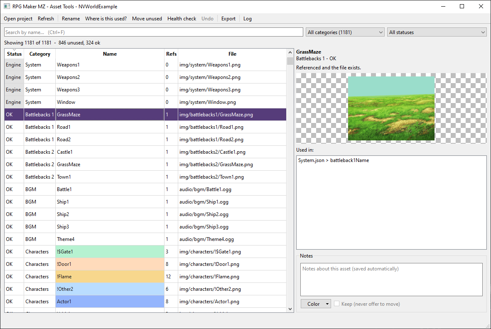
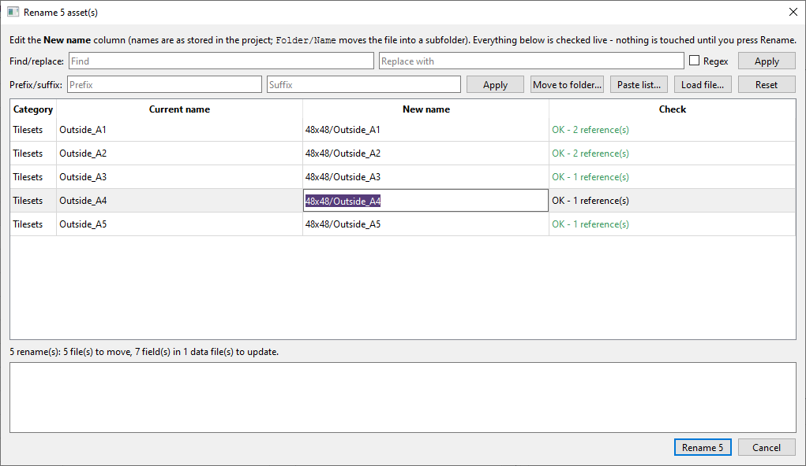
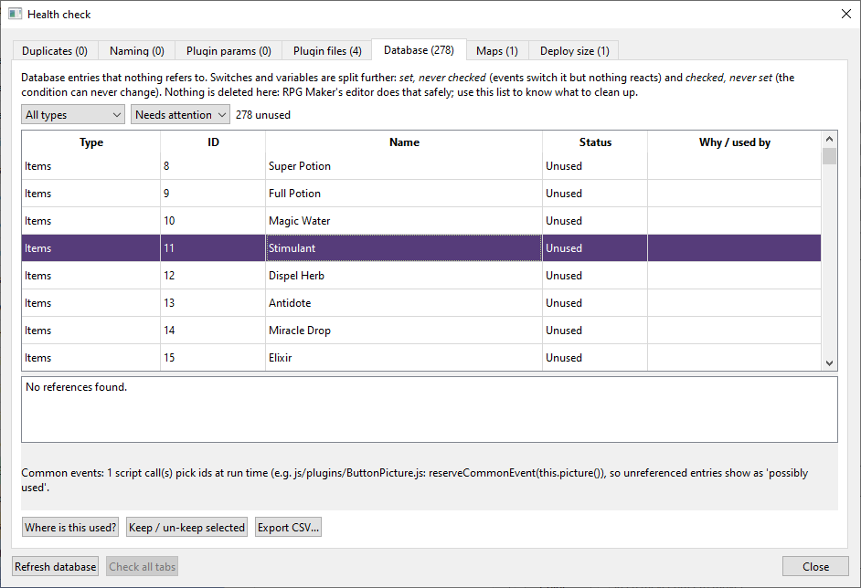

# RPG Asset Tools for RPG Maker MZ

A desktop tool that finds unused and missing assets in an RPG Maker MZ project, and renames, merges or
moves them **without breaking the project**. Every reference (event commands, database fields, plugin
parameters, notes) is updated together with the file, and every change can be undone.



It also has a Health check with seven on-demand reports: duplicate files, naming problems, plugin
parameters and plugin files, unused database entries (including switches and variables), unreachable maps
and stray files in `data/`, and a deploy-size summary.

Built for big projects: tested on a game with about 5,600 assets and 1.5 GB of data.

> **Work on a copy the first time.** Every change can be undone and the app asks you to confirm you have a
> copy, but a copy costs nothing. Close RPG Maker MZ before you change anything.

## What it does

- **Asset list** with a status per file: *OK*, *Missing*, *Unused*, *Possible*, *Engine*, *Kept*.
- **Rename** one or many assets with a live preview of every file and data field that will change;
  find/replace with regex, prefix/suffix, move to folder, paste a list from a spreadsheet, load a CSV.
- **Move unused** assets into `_unused/` folders next to the originals, **merge duplicates**, and **undo** all of it.
- **Plugins are real references**: parameters and commands declared `@type file` count as used and are
  rewritten on rename. Includes support for Galv's Layer Graphics.
- **Where is this used?** shows each reference as a path you can follow in the editor
  (`Town (Map001) > event 3 'Guard' at (12, 8) > page 2 > line 5: Show Picture`).
- **Health check**: Duplicates, Naming, Plugin params, Plugin files, Database, Maps, Deploy size.
  Each tab runs only when you ask, so the window opens instantly.

  
  

## Requirements

- Python 3.9 or newer, 64-bit
- [PySide6](https://pypi.org/project/PySide6/) 6.5 or newer (installed with pip; it is the only dependency)

Developed and tested on Windows with Python 3.12 and PySide6 6.12. Linux and macOS should work but have
not been tried with the real window.

## Install and run

```bash
git clone https://github.com/volpison/rpg-asset-tools.git
cd rpg-asset-tools/rpg_asset_tools
pip install -r requirements.txt
python main.py
```

On Windows you can double-click `rpg_asset_tools/check_dependencies.bat` instead. It finds Python,
checks the version and PySide6, offers to install what is missing and to start the app.
Options: `/install`, `/nolaunch`, `/nopause`.

Then choose your project folder (the one that contains `data/`, `img/` and `audio/`).

## Safety

- One backup per operation, in `<project>/.asset_tools/backups/`. Undo restores it, and refuses (with the
  reason) if something else changed those files since, so work done in RPG Maker afterwards is never lost.
- Files are moved first and JSON is written second; any failure rolls both back.
- If any `data/*.json` cannot be parsed, moving and renaming are disabled, because references would be invisible.
- It never deletes your assets: unused files are moved to an `_unused` folder. The only things it removes
  are its own cache files, backups beyond the newest 20, and folders it has just emptied.
- The app stores its own files in `<project>/.asset_tools/`. **Exclude that folder from your release build**
  and from Git (`.asset_tools/` in your game's `.gitignore`).

## Limits

The tool cannot see asset names that are built at run time (`"Pic" + n`), plugin parameters whose header
does not declare `@type file` (until you map them), or third-party notetag conventions. Those assets show up
as *Possible* or *Unused*. Check *Unused* once before moving and use *Keep* for anything it cannot know about.
The full list is in the [manual](docs/MANUAL.md#what-it-cannot-see) and the
[changelog](CHANGELOG.md).

## Documentation

- [User manual](docs/MANUAL.md): every screen, every Health tab, plugin support, caches and troubleshooting.
- [Developer guide](docs/DEVELOPMENT.md): code layout, running the tests, the real-window smoke test.
- [Changelog](CHANGELOG.md)

## Tests

```bash
python -m unittest discover -s tests
```

The unit tests need no Qt. To check the real window, run `python rpg_asset_tools/smoke_test_qt.py`
(see the developer guide).

## Reporting a bug

Open an issue and choose *Bug report*. If the window froze, attach `~/.rpg_asset_tools/hang.log`
(Windows: `%USERPROFILE%\.rpg_asset_tools\hang.log`). Please do not attach project files you do not
have the right to share.

## License

[MIT](LICENSE). PySide6 is installed separately and has its own license (LGPLv3 / GPLv3 / commercial).

This project is not affiliated with or endorsed by the makers of RPG Maker (Gotcha Gotcha Games).

"RPG Maker" is a registered trademark of Gotcha Gotcha Games Inc.
